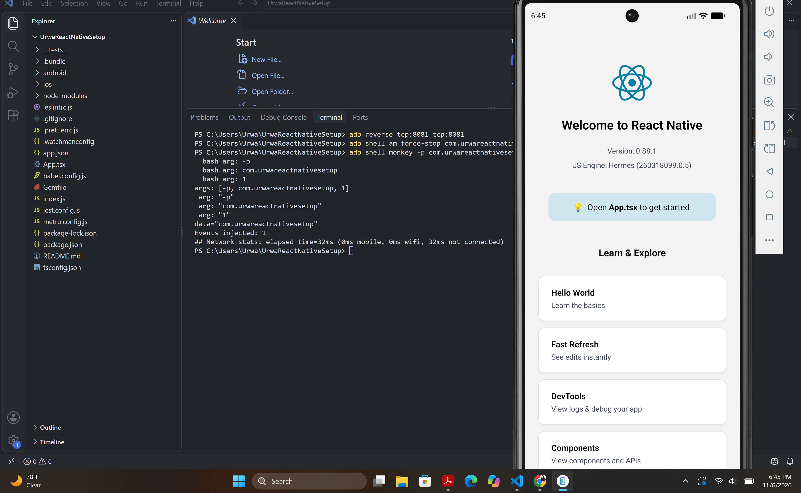
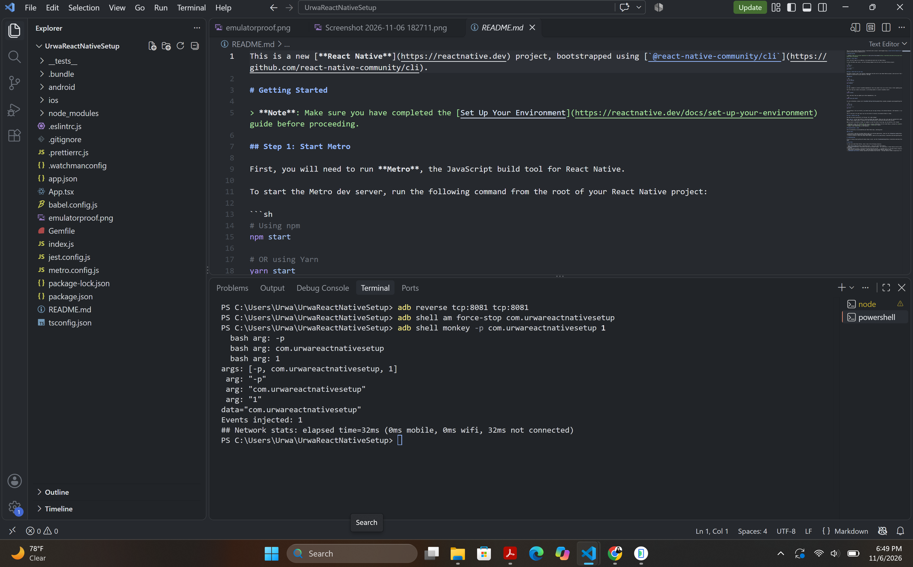

# Urwa React Native Setup

## Assignment Details
- University: University of Management and Technology (UMT)
- Subject: Mobile Application Development
- Assignment: 1
- Student: Urwa

## Project Description
This project was created using React Native Community CLI. The application was successfully built and executed on an Android Pixel 6 Emulator.

## Screenshots

### Emulator Proof


### Project Structure


## Technologies Used
- React Native
- JavaScript / TypeScript
- Android Studio
- Android SDK
- Visual Studio Code
- Git and GitHub

## Execution
Run the following command to start the application:

```bash
npx react-native start
```

In another terminal, run:

```bash
npx react-native run-android
```
